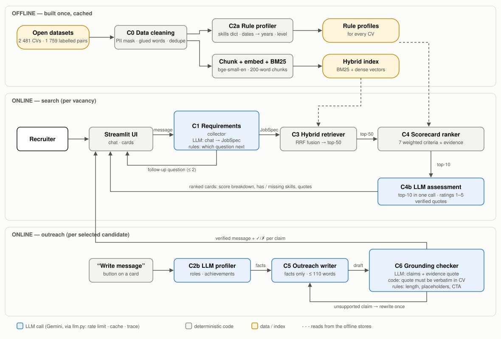

# Recruiter Assistant

An NLP system that helps a recruiter go from a vacancy to a shortlist:

1. **C1 Requirements collector** — chat with the recruiter, extract a structured
   `JobSpec`, ask follow-up questions for missing mandatory fields.
2. **C3 Hybrid retriever** — BM25 + dense embeddings (bge-small, chunked CVs), RRF fusion.
3. **C4 Scorecard ranker** — transparent weighted criteria with evidence from the CV;
   **C4b** LLM gives recruiter-style ratings with verified quotes.
4. **C2a / C2b CV profilers** — rule-based facts for every CV; LLM profile for the shortlist.
5. **C5 Outreach writer + C6 grounding checker** — LinkedIn message that uses only facts
   from the CV; every claim is verified against the CV and failing drafts are rewritten.

**Final report:** [`report.ipynb`](report.ipynb) (also [`report.html`](report.html)) — task and
business logic, data, diagram, walk-through of one input, evaluation of every component,
CRISP-DM loop-backs, how the coding agent was managed.
Detailed evaluation: [`docs/05_evaluation.md`](docs/05_evaluation.md) · design:
[`docs/architecture.md`](docs/architecture.md) · diagram:
[`docs/figures/architecture.svg`](docs/figures/architecture.svg).



## Setup

Requires Python 3.12 and [uv](https://docs.astral.sh/uv/).

```bash
uv sync                                   # install dependencies
cp .env.example .env                      # then put your GEMINI_API_KEY into .env
uv run python scripts/download_data.py    # open datasets from Hugging Face -> data/raw
uv run python scripts/prepare_data.py     # cleaning (C0) -> data/processed
uv run python scripts/check_llm.py        # 1 request per configured model
```

The LLM is Google Gemini through its OpenAI-compatible API. All calls go through
`src/recruiter/llm.py`, which enforces the free-tier limits on the client side
(sliding 60 s window + daily budget, persisted across runs), retries 429/5xx/timeouts,
caches every response in `data/cache/` and logs every call to `traces/YYYY-MM-DD.jsonl`.

## Run the app

```bash
uv run streamlit run app.py
```

The first start downloads the embedding model and builds the index for 2 481 CVs
(7–15 min on a laptop, then cached in `data/processed/`; later starts take seconds).
LLM tracing: every call is logged to `traces/YYYY-MM-DD.jsonl`; view the latest with
`uv run python scripts/show_traces.py --n 10 [--full]`.
Each recruiter message costs 1 LLM call; "Explain top-10" costs 1 call; a LinkedIn
message costs 2–5 calls (profile, write, check, optional rewrite).

## Tests and evaluations

```bash
uv run ruff check . && uv run pytest -q          # fast, no network
```

| Component | Script | LLM calls | Result file |
|---|---|---|---|
| C0 cleaning | `scripts/prepare_data.py` | 0 | `eval/results/data_cleaning.json` |
| C2a / C2b profilers | `eval/eval_profiler.py` | 30 (cached) | `eval/results/profiler.json` |
| JobSpec for benchmark JDs | `scripts/extract_benchmark_jobspecs.py` | 0 (71 with `--force`) | `eval/results/benchmark_jobspecs.json` |
| Quality of those JobSpecs | `eval/eval_benchmark_jobspecs.py` | 0 | `eval/results/benchmark_jobspecs_quality.json` |
| C3 retriever | `eval/eval_retrieval.py` | 0 | `eval/results/retrieval.json` |
| C4 ranker | `eval/eval_ranker.py` | 0 | `eval/results/ranker.json` |
| C4b LLM re-ranker | `eval/eval_reranker_llm.py` | 61 (cached) | `eval/results/reranker_llm.json` |
| C1 collector (simulated dialogs) | `eval/eval_collector.py` | ~90 (cached) | `eval/results/collector.json` |
| C5 + C6 outreach | `eval/eval_outreach.py` | ~70 (cached) | `eval/results/outreach.json` |
| C6 judge validation | `eval/eval_grounding_judge.py` | 0 | `eval/results/grounding_judge.json` |

All result files are committed, including `eval/results/benchmark_jobspecs.json` (the
LLM-extracted JobSpecs that C3/C4/C4b/C5 evals read). On a fresh clone:
- C0 cleaning is `prepare_data.py` itself — running it regenerates `data_cleaning.json`.
- After `download_data.py` and `prepare_data.py`, the evals with 0 LLM calls — C3, C4,
  C6 judge validation and `eval/eval_benchmark_jobspecs.py` — re-run without an API key.
  They are not fully offline: C3/C4 download the embedding model (bge-small) from Hugging
  Face on first use.
- `extract_benchmark_jobspecs.py` skips JDs that already have a spec (0 calls); `--force`
  re-extracts them.
- The LLM cache (`data/cache/`) is not committed, so re-running an LLM eval makes the
  listed number of real calls — check the daily budget first.

Benchmarks and gold sets are described in [`eval/gold/README.md`](eval/gold/README.md).

Rebuild the report and diagram:
```bash
uv run python scripts/make_diagram.py
uv run python scripts/build_report.py
uv run jupyter nbconvert --to notebook --execute --inplace report.ipynb
uv run jupyter nbconvert --to html report.ipynb
```

## Data

- Candidate DB: [`opensporks/resumes`](https://huggingface.co/datasets/opensporks/resumes)
  (Kaggle Resume Dataset mirror, 2 484 anonymised CVs, 24 categories).
- Benchmark: [`cnamuangtoun/resume-job-description-fit`](https://huggingface.co/datasets/cnamuangtoun/resume-job-description-fit)
  (1 759 resume–JD pairs labelled No / Potential / Good Fit).

## How the project was built (CRISP-DM + coding agent)

- [`AGENTS.md`](AGENTS.md) (imported by `CLAUDE.md`) — rules for the coding agent:
  mandatory CRISP-DM phases, "no component without an evaluation", LLM budget rules,
  prompts versioned in `prompts/`, Pydantic contracts, code conventions.
- [`.claude/skills/`](.claude/skills/) — reusable workflows: `crisp-dm`,
  `data-exploration`, `new-component`, `component-eval`.
- [`docs/crisp_dm_log.md`](docs/crisp_dm_log.md) — the phase-by-phase log, including
  every loop-back and the metric that triggered it.

## Repository layout

```
app.py                  Streamlit UI
src/recruiter/          components: collector, jobspec, profiler_rules, profiler_llm,
                        retrieval, ranker, reranker_llm, pipeline, llm, metrics, schemas
prompts/                versioned LLM prompts
scripts/                data download / preparation / one-off extraction
eval/                   evaluation scripts, gold sets, results
docs/                   CRISP-DM documents, architecture, evaluation report
tests/                  unit tests (LLM mocked)
```
