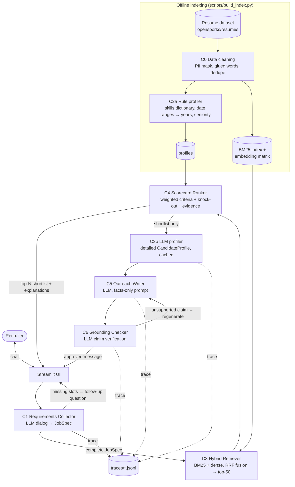

# Architecture

## Data flow

**Why the profiler is split (C2a / C2b):** the Gemini free tier allows only a
few hundred requests per day, so LLM-profiling all 2 481 CVs is not feasible.
Ranking needs only skills, years and seniority, which rules extract cheaply for
the whole DB (C2a). The richer LLM profile (C2b: achievements, evidence quotes)
is needed only for the 5–10 shortlisted candidates and is cached. The two are
compared on the same gold set — this is also an ablation for the report.

## Components

| ID | Component | Purpose | Input | Output | Calls |
|---|---|---|---|---|---|
| C0 | Data cleaning | Make CV text usable, mask PII, remove duplicates | raw parquet | `id, category, text` | — |
| C1 | Requirements Collector | Turn a free dialog into a structured vacancy; ask follow-ups for missing mandatory slots | chat history | `JobSpec` + next question | LLM (structured output) |
| C2a | Rule profiler | Cheap facts for every CV, offline | cleaned CV | skills, years, seniority, titles | regex + skills dictionary |
| C2b | LLM profiler | Rich facts for shortlisted CVs, on demand | cleaned CV | `CandidateProfile` (titles, years, seniority, skills, domains, achievements) | LLM (structured output), cached |
| C3 | Hybrid Retriever | Cheap, high-recall candidate search | `JobSpec` | top-50 resume ids | BM25 (rank_bm25), embeddings (sentence-transformers) |
| C4 | Scorecard Ranker | Business-logic ranking with explanation | `JobSpec`, profiles | ranked `CandidateScore` list with per-criterion scores + evidence | deterministic (+ embeddings for title similarity) |
| C5 | Outreach Writer | Personalised LinkedIn message | `JobSpec`, `CandidateProfile`, `CandidateScore` | `OutreachMessage` | LLM |
| C6 | Grounding Checker | Guardrail against hallucinated facts | message + CV | claims with supported / unsupported verdicts | LLM (judge) |

## Walk-through of one input
1. Recruiter: *"Looking for a senior data engineer, Spark and Python are a must."*
2. **C1** extracts `title`, `seniority=senior`, `must_have=[spark, python]`;
   minimum years is missing → asks *"How many years of experience at minimum?"*
3. Recruiter answers "5+" → `JobSpec` complete → **C3** builds a query from the
   spec, gets BM25 and dense rankings, fuses them with RRF → 50 candidates.
4. **C4** loads their profiles, computes each criterion, applies the knock-out
   rule, sorts by weighted score, attaches evidence (matched skills, titles).
5. UI shows the top-5 with score breakdown. Recruiter clicks "Write message".
6. **C5** writes a message from profile facts; **C6** splits it into claims and
   checks each against the CV; unsupported claims trigger one regeneration.
7. The approved message is shown; every LLM call is logged to `traces/`.

## Datasets
- **Candidate DB (demo):** `opensporks/resumes` (Kaggle Resume Dataset mirror,
  2 484 CVs, 24 categories).
- **Ranking/retrieval benchmark:** `cnamuangtoun/resume-job-description-fit`
  (test split: 1 759 resume–JD pairs, 71 JDs, labels No / Potential / Good Fit).
